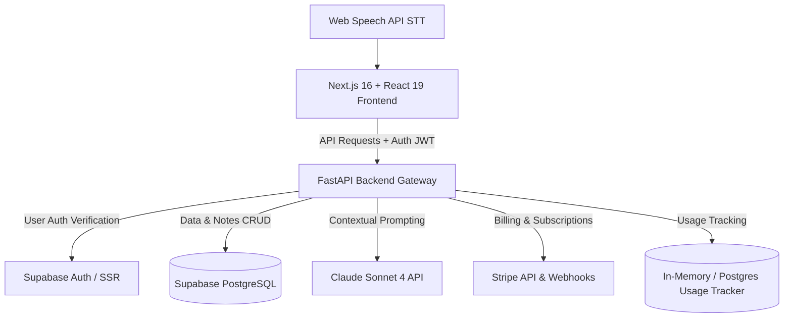

# 🧬 Synapse

<p align="center">
  
  
  
  
  
  
</p>

---

## 📖 Overview

**Synapse** is an **AI-powered lecture intelligence platform** that works as a second brain for students, teachers and researchers. Feed it a lecture in almost any form (live voice recording, a YouTube link, a PDF, slides, handwritten notes or audio) and it returns a complete study kit: structured notes, flashcards, timed quizzes, auto-generated concept diagrams and multi-agent deep research.

Under the hood it ships with **Supabase authentication**, **shared team workspaces** and a complete **Stripe subscription billing** layer, so it behaves like a real SaaS product rather than a demo.

---

## ✨ Key Features

Everything below is implemented and working today.

### 📥 Multi-Channel Lecture Ingestion
*   🎙️ **Live recording**: capture the microphone and transcribe in the browser with the Web Speech API.
*   📺 **YouTube import**: paste a public video link and the backend pulls the transcript and sends it through the AI pipeline.
*   📄 **File uploads**: PDFs, PowerPoint decks, images of handwritten notes, audio files, plus plain transcripts and text summaries.

### 🧠 Claude-Powered Intelligence
*   📝 **Study notes**: summaries, key takeaways, exam-prep questions and reminders generated from each lecture.
*   📊 **Concept maps**: **Mermaid.js** diagrams are produced automatically to show how ideas or events connect.
*   💬 **Chat with your lectures**: ask questions, request deeper explanations or clarify topics against the context of your own notes.
*   🔬 **Deep research over SSE**: a multi-agent run that analyses your notes and streams live progress to the browser via Server-Sent Events.

### 🗂️ Study Tools & Collaboration
*   📇 **Flashcards**: decks generated automatically and grouped by topic and difficulty.
*   ❓ **Quizzes**: multiple-choice practice exams with a timer, created on demand.
*   👥 **Team workspaces**: shared folders for study groups and projects, governed by role-based access control (RBAC) with four roles: `Owner`, `Admin`, `Editor` and `Viewer`.

### 💳 Billing & Usage Control
*   🔐 **Authentication**: sessions handled end to end by Supabase SSR auth.
*   💳 **Subscription plans**: four tiers (Explorer, Pro, Premium, Team) kept in sync with Stripe billing intervals.
*   ⚡ **Daily quotas**: per-plan limits on AI queries, YouTube imports, flashcard generations and quiz generations keep API costs under control.

### 🔒 Security & Data Isolation
*   🛡️ **Row-Level Security (RLS)**: Postgres policies make sure users can only read, write or delete their own notes and flashcards.
*   🔑 **JWT verification**: every backend request carries a Supabase access token, which FastAPI dependencies verify with `SUPABASE_JWT_SECRET` before any router runs.
*   📦 **Secrets stay server-side**: Anthropic/Groq keys, Stripe keys and the Supabase service-role key never reach the browser bundle.

---

## 🛠️ Architecture & Tech Stack



### Stack at a Glance

| Layer | Technologies |
|---|---|
| **Frontend** | React 19 · Next.js 16 (App Router) · TypeScript · Tailwind CSS v4 · Framer Motion · shadcn/ui |
| **Backend** | FastAPI · Pydantic · Python 3.10+ · Uvicorn |
| **Database** | Supabase PostgreSQL |
| **Authentication** | Supabase SSR session provider |
| **AI Processing** | Claude Sonnet 4 via the Anthropic API (Groq available as an alternative provider) |
| **Payments** | Stripe (Checkout, Webhooks, Billing Portal) |
| **Diagrams** | Mermaid.js (client-side rendering) |

---

## 📂 Repository Structure

```
synapse/
├── frontend/
│   ├── app/
│   │   ├── (auth)/             # Login and sign-up screens
│   │   ├── ask/                # AI chat Q&A and deep research
│   │   ├── flashcards/         # Flashcard review
│   │   ├── notes/              # Notes library, detail view and editor
│   │   ├── pricing/            # Plan cards and Stripe checkout
│   │   ├── quiz/               # Multiple-choice quizzes
│   │   ├── record/             # Live recording and transcript view
│   │   ├── search/             # Global full-text search
│   │   ├── settings/           # Billing and account settings
│   │   ├── youtube/            # YouTube transcript import
│   │   ├── globals.css         # Tailwind v4 setup and design tokens
│   │   └── layout.tsx          # Root layout with the sidebar dock
│   ├── components/             # Custom components and shadcn/ui primitives
│   ├── lib/                    # Supabase SSR clients, API helpers, TS utilities
│   └── package.json
├── backend/
│   ├── app/
│   │   ├── main.py             # App creation and CORS setup
│   │   ├── config.py           # Settings loaded with Pydantic BaseSettings
│   │   ├── dependencies.py     # Shared FastAPI dependencies (auth, DB, settings)
│   │   ├── middleware/         # Auth and subscription/limit checks
│   │   ├── migrations/         # PostgreSQL schema SQL scripts
│   │   ├── models/             # Database client and Pydantic schemas
│   │   ├── routers/            # API routes (notes, youtube, ask, billing, workspaces, ...)
│   │   └── services/           # Business logic (ai_service, stripe_service, usage_service)
│   ├── requirements.txt        # Python dependencies
│   └── .env.example            # Environment variable template
├── docs/                       # PRD, architecture, rules and roadmap
└── README.md                   # You are here
```

---

## ⚙️ Local Development Setup

### 1. Prerequisites
You will need:
*   **Node.js** v18 or newer
*   **Python** 3.10 or newer
*   A **Supabase** account with a project
*   An **Anthropic API key** (or a Groq key if you prefer that provider)
*   A **Stripe** developer account

### 2. Initialise the Database
Run the SQL scripts in [`backend/app/migrations`](backend/app/migrations) from the Supabase SQL editor or the Supabase CLI, in this order:
1.  `001_subscription_tables.sql` creates the subscription, daily-usage and payment tables and seeds the Explorer, Pro, Premium and Team plans.
2.  `002_team_workspaces.sql` adds workspaces and memberships, and links notes to workspaces.

### 3. Run the Backend
1.  Move into the backend folder:
    ```bash
    cd backend
    ```
2.  Create and activate a virtual environment:
    ```bash
    python -m venv venv
    source venv/bin/activate  # Windows: venv\Scripts\activate
    ```
3.  Install the dependencies:
    ```bash
    pip install -r requirements.txt
    ```
4.  Create your environment file:
    ```bash
    cp .env.example .env
    ```
    Then fill in `.env`:
    *   `ANTHROPIC_API_KEY`: your Anthropic key.
    *   `SUPABASE_URL`, `SUPABASE_SERVICE_KEY`, `SUPABASE_JWT_SECRET`: from your Supabase project settings.
    *   `STRIPE_SECRET_KEY`, `STRIPE_WEBHOOK_SECRET`, `STRIPE_PRICE_*`: your Stripe secrets and price IDs.

5.  Start the API server:
    ```bash
    uvicorn app.main:app --host 0.0.0.0 --port 8000 --reload
    ```

### 4. Run the Frontend
1.  Move into the frontend folder:
    ```bash
    cd frontend
    ```
2.  Install the packages:
    ```bash
    npm install
    ```
3.  Create a `.env.local` file in `frontend/` with your Supabase and API settings:
    ```env
    NEXT_PUBLIC_SUPABASE_URL=https://your-project-ref.supabase.co
    NEXT_PUBLIC_SUPABASE_ANON_KEY=your-supabase-anon-key
    NEXT_PUBLIC_API_URL=http://localhost:8000
    ```
4.  Start the dev server:
    ```bash
    npm run dev
    ```
5.  Open [http://localhost:3000](http://localhost:3000) in your browser.

---

## 📊 Database Schema

Synapse stores its data in a relational PostgreSQL database hosted on Supabase. The main tables relate like this:

```
                  ┌───────────────┐
                  │  auth.users   │
                  └───────┬───────┘
                          │
         ┌────────────────┼────────────────┬───────────────┐
         ▼                ▼                ▼               ▼
┌─────────────────┐ ┌───────────┐ ┌────────────────┐ ┌───────────┐
│user_subscriptions│ │workspaces │ │  usage_daily   │ │   notes   │
└────────┬────────┘ └─────┬─────┘ └────────────────┘ └─────┬─────┘
         │                │                                │
         ▼                ▼                                ▼
┌─────────────────┐ ┌───────────┐                    ┌───────────┐
│ payment_history │ │wksp_members│                    │flashcards │
└─────────────────┘ └───────────┘                    └───────────┘
```

*   **`notes`**: summaries, topics and tags, raw transcripts, key points, study schedules and Mermaid diagrams, each scoped to a `workspace_id`.
*   **`flashcards`**: AI-generated cards with question, answer, display order and difficulty.
*   **`workspaces`** and **`workspace_members`**: teams, shared folders and each member's RBAC role.
*   **`subscription_plans`** and **`user_subscriptions`**: available tiers, each user's current plan, Stripe sync data and billing dates.
*   **`usage_daily`**: a daily counter of operations (YouTube imports, AI queries and so on) used to enforce plan limits.

---

---

## 🤝 Contributing

Contributions are welcome. Before opening a pull request, read [docs/rules.md](docs/rules.md) for the architecture guidelines, naming conventions and PR rules.

---


---

## 👨‍💻 Author

**Aayush** — [GitHub](https://github.com/codeitwithaayush)
